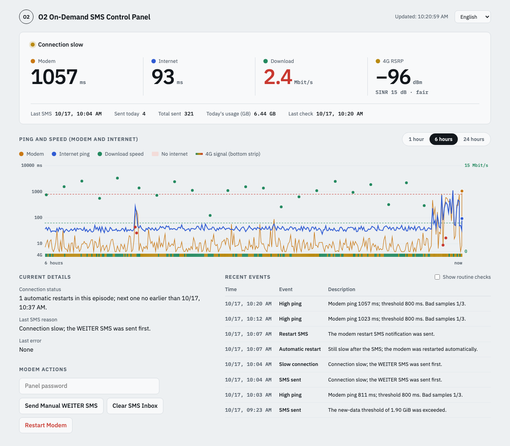
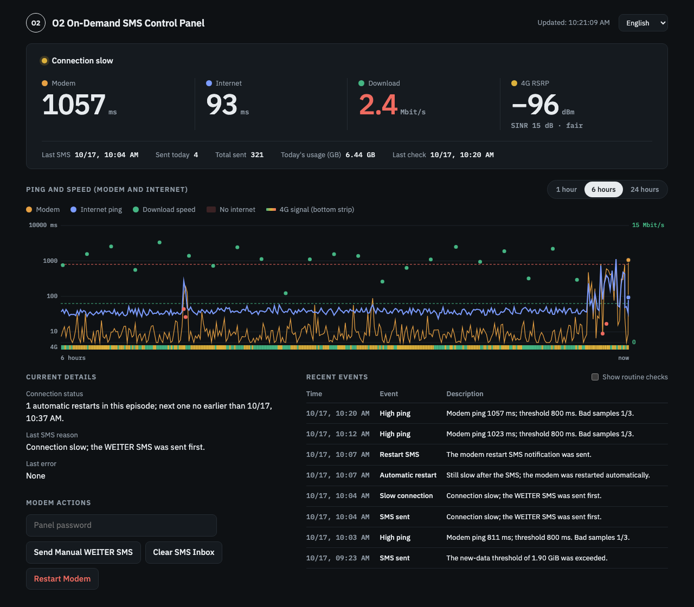
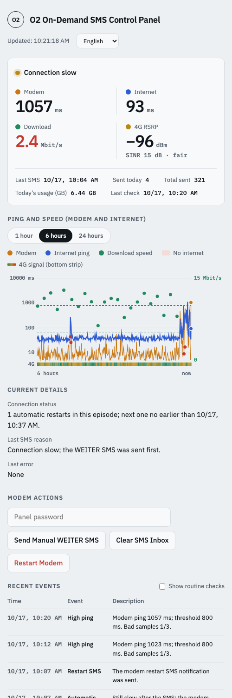
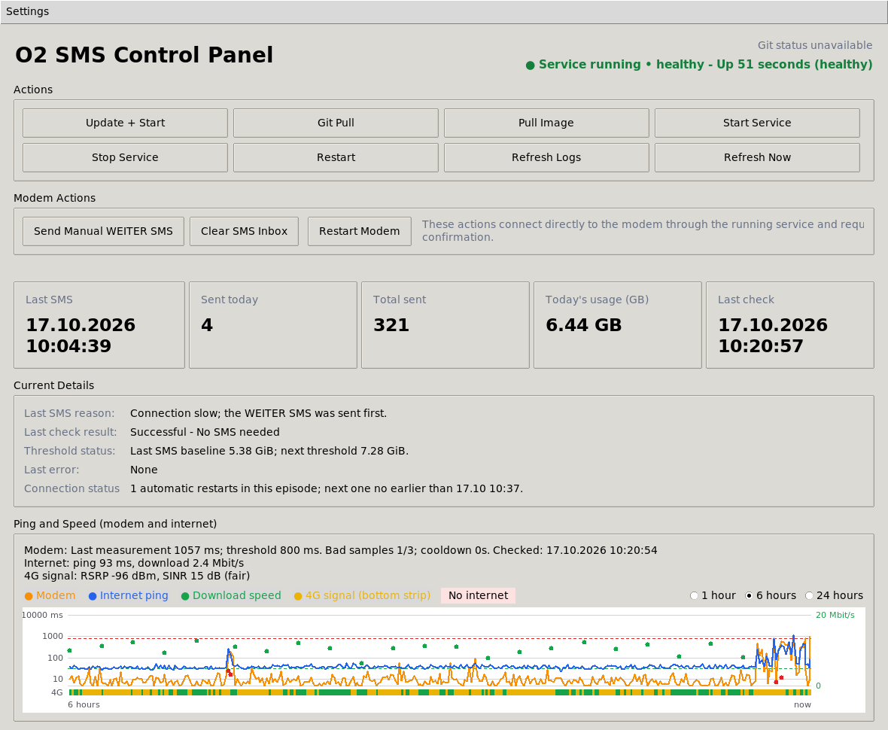

# O2 On-Demand SMS Sender

Keeps an O2 Unlimited On Demand line at full speed. A small service talks to
your Huawei LTE/5G modem, sends the free `WEITER` SMS whenever the next 2 GB of
high-speed data is due, and restarts the modem carefully when the connection
gets slow. A web panel and a desktop app show what it is doing.



It works with the Huawei modems and routers that
[huawei-lte-api](https://github.com/Salamek/huawei-lte-api) supports; check
that list for your model.

## Quick start

Setup takes about five minutes.

**You need**

- the modem's admin username and password (the ones you use on its web page);
- the modem's address, which is the address of that web page, for example
  `192.168.8.1`;
- a computer that stays on and is connected to the modem's network
  (a Raspberry Pi, a NAS or an always-on Mac or PC);
- [Docker](https://docs.docker.com/get-started/get-docker/) on that computer
  (Docker Desktop on macOS and Windows, Docker Engine on Linux).

**1. Download the project**

```bash
git clone https://github.com/e-onux/o2-on-demand-sms-sender.git
cd o2-on-demand-sms-sender
```

No Git? Download the ZIP from the green **Code** button on GitHub and unpack it.

**2. Enter the modem login**

```bash
cp .env.example .env
```

Open `.env` in any text editor and change these three lines:

```dotenv
API_USER=admin
API_PASSWORD=the-modem-password
MODEM_HOST=192.168.8.1
```

To use the web panel from your phone or other computers, also set:

```dotenv
WEB_PANEL_ENABLED=true
WEB_PANEL_PASSWORD=pick-a-long-password
```

**3. Start it**

```bash
docker compose pull
docker compose up -d
```

The first start downloads a ready-made image (Linux amd64/arm64/armv7, and
Docker Desktop on macOS/Windows). If the download is not possible, build it
locally instead with `docker compose up -d --build`.

**4. Check that it works**

```bash
docker compose logs -f
```

After about a minute you should see `Logged in!` and a line such as
`Current usage: 3.42 GiB`. Press Ctrl+C to leave the log; the service keeps
running and starts again after a reboot.

**5. Open the web panel** (if you enabled it)

Open `http://<computer-name>:8095` on any device in the same network, for
example `http://raspberrypi.local:8095` or `http://homenas.local:8095`. The
computer name is more reliable than its IP address, which the router may
change. Viewing needs no password; sending an SMS or restarting the modem asks
for `WEB_PANEL_PASSWORD`.

**6. Desktop app** (optional)

The desktop app adds Docker controls (start, stop, update, logs) on the
computer that runs the service.

- macOS (Apple silicon): run `zsh gui/scripts/build_macos.sh`, then open
  `gui/build/macos-arm64/O2 SMS Kontrol Paneli.dmg` and drag the app to
  Applications.
- Windows and Linux: download the latest build from the
  [Build GUI applications](https://github.com/e-onux/o2-on-demand-sms-sender/actions/workflows/gui-build.yml)
  workflow (sign in to GitHub, open the newest run, then **Artifacts**), or run it from source
  with `python3 gui/src/control_panel.py`.

Details are in [gui/README.md](gui/README.md).

### Update, stop, remove

```bash
git pull && docker compose pull && docker compose up -d   # update
docker compose down                                       # stop
```

Statistics and history stay in the `data` folder; keep it when you update.

### Troubleshooting

| What you see | What to do |
|---|---|
| `Failed to login after several attempts` or another login error in the log | Check `API_USER` and `API_PASSWORD` in `.env`, then run `docker compose up -d` again. Log out of the modem's web page first; some modems allow only one session. |
| Timeouts or `Connection refused` to the modem | Check `MODEM_HOST`: open `http://<MODEM_HOST>` in a browser on the same computer. |
| The web panel does not open | Check that `WEB_PANEL_ENABLED=true` is in `.env` and run `docker compose up -d`. Try the computer's IP address instead of its name. Firewalls must allow port 8095. |
| The web panel buttons say actions are disabled | Set `WEB_PANEL_PASSWORD` in `.env` and run `docker compose up -d`. |
| Gaps in the chart | The computer was asleep or off. A laptop with the lid closed sleeps on battery; keep it on power. |
| "Cannot measure" under connection status | The service cannot reach the internet from inside Docker (DNS or firewall). It takes no automatic action while this lasts. |

## How it works

The worker checks the modem once per minute by default. It sends `WEITER` when
either condition is met:

- the configured new-data threshold is reached (1.9 GiB by default, allowing
  for reporting delay around O2's 2 GB boundary), or
- an O2 SMS reports that 80% of the high-speed allowance has been used or that
  the allowance is exhausted.

An O2 trigger immediately moves the usage baseline to the verified current byte
counter. Periodic threshold checks then continue from that new baseline.
Processed trigger messages are fingerprinted so a retained message cannot send
the same reply again.

The incoming and sent SMS folders are treated as one timeline. Only the newest
three messages are retained by default. Runtime event history, processed
fingerprints, Docker logs, and the GUI log view are all bounded for long-running
installations.

### Slow-connection recovery

The worker also watches the connection itself. Every run times a tiny HTTP
request to a few public connectivity-check endpoints; a 1 MB download probe runs
every 15 minutes (about 100 MB/day) and on every run while a slowdown is being
confirmed. A probe counts as slow below 5 Mbit/s, or below 35% of the line's
usual healthy speed once enough history exists; very high latency also counts.
Probes that fail outright (DNS or routing errors inside Docker, for example)
never trigger an action, because a modem restart cannot fix them; the control
panel shows "cannot measure" instead.

The 4G signal (RSRP/SINR) is read from the modem every run and shown as a
coloured strip under the chart. When it is weak (RSRP below -105 dBm or SINR
below 0 dB) the restart notification SMS says so, for example
`Modem yeniden baslatiliyor. 4G sinyal zayif: RSRP -112 dBm, SINR -3 dB.`
The existing modem-ping watch and this recovery share one restart marker, and
this recovery waits 10 minutes after any automatic restart before deciding.

When the connection stays slow, recovery escalates instead of looping:

1. two slow measurements in a row: send `WEITER` once;
2. still slow two minutes later: restart the modem;
3. further restarts only after 30 min, 3 h, 6 h, 12 h, then 24 h, and never
   more than 4 restarts in any 24 hours.

The ladder resets only after an hour of healthy probes, so a rainy day with a
weak signal costs at most a few restarts. The control panel charts latency and
download speed for the last 1, 6 or 24 hours and shows the current phase. Set
`WATCHDOG_ENABLED=false` to turn the feature off; the SMS renewal is unaffected.

## Web panel



The web panel runs inside the same container when `WEB_PANEL_ENABLED=true`
(port `WEB_PANEL_PORT`, default 8095). It shows the live readout (modem ping,
internet ping, download speed, 4G signal), the ping/speed chart, the current
recovery phase and recent events. Sending `WEITER`, clearing the SMS inbox and
restarting the modem need `WEB_PANEL_PASSWORD`; without it these actions are
disabled. Five wrong passwords lock a device out for five minutes. The page
follows the light or dark system setting and offers Turkish, English, German,
Polish and Russian (from the browser, the language menu or `?lang=de`).



The panel uses plain HTTP and is meant for the home network only; do not
forward its port on the router. Docker controls stay in the desktop app.

## Desktop control panel



The Tkinter control panel is located under `gui/`. It can:

- update and operate the Docker Compose service;
- show service health, verified daily usage, SMS statistics, thresholds,
  errors, recent events, and Docker logs;
- chart modem ping, internet ping, download speed and the 4G signal, and show
  the slow-connection recovery phase;
- send a confirmed manual `WEITER` SMS or restart the modem after a separate warning;
- clear the modem SMS inbox and copy or clear event history;
- disable Docker-dependent controls while Docker Engine is unavailable, and
  modem controls while the worker service is not running;
- switch between Turkish, English, German, Polish, and Russian;
- minimize to the system tray and optionally start minimized at user login.

Platform builds and installation details are documented in
[gui/README.md](gui/README.md). Docker Desktop or Docker Engine must be
running for service controls and status collection.

## Configuration reference

All settings live in `.env` (start from `.env.example`). The defaults are
shown below; only the modem login and address are required.

```dotenv
API_USER=your_username_here
API_PASSWORD=your_password_here
MODEM_HOST=192.168.8.1
INTERVAL_SECONDS=60
SMS_THRESHOLD_GB=1.9
SMS_RETENTION_COUNT=3
TZ=Europe/Berlin

# Slow-connection recovery (defaults shown)
WATCHDOG_ENABLED=true
WATCHDOG_MIN_DOWNLOAD_MBPS=5
WATCHDOG_RELATIVE_SLOW_FACTOR=0.35
WATCHDOG_SLOW_PING_MS=400
WATCHDOG_SPEED_INTERVAL_SECONDS=900
WATCHDOG_SMS_WAIT_SECONDS=120
WATCHDOG_RESTART_BACKOFF_MINUTES=30,180,360,720,1440
WATCHDOG_RECOVERY_SECONDS=3600
WATCHDOG_MAX_RESTARTS_PER_DAY=4
```

Advanced: `WATCHDOG_PING_TARGETS` (default
`cp.cloudflare.com/generate_204,connectivitycheck.gstatic.com/generate_204,www.msftconnecttest.com/connecttest.txt`),
`WATCHDOG_SPEED_URL`, `WATCHDOG_SPEED_BYTES`, `WATCHDOG_CONFIRM_COUNT`.

## Portainer and image builds

See [README.DOCKER.md](README.DOCKER.md) for running the stack from Portainer
and for the multi-arch image build.

## Run directly with Python

```bash
python3 -m venv venv
venv/bin/pip install -r requirements.txt
venv/bin/python o2_on_demand_hack.py
```

On Windows, activate the environment with `venv\Scripts\activate` and use the
corresponding Python executable.

## Tests

```bash
venv/bin/python -m unittest discover -s tests -v
```

The suite covers modem date parsing, verified counter resets, trigger
idempotency, SMS retention, long-running event compaction, decimal usage
display, slow-connection escalation and its daily cap, translations, action availability, confirmation gates, and desktop
project discovery.

